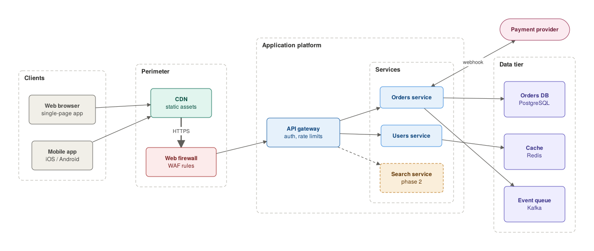

# Backroom

**A private AI workspace for confidential work. It runs entirely on your own machine and knows your documents and your company's style.**

Built for people who can't paste their work into cloud AI tools because of NDAs, client contracts or security policy.

Backroom connects a local model (Ollama or LM Studio) to a private search index of your own files, and puts it to work:

| Command | What you get |
|---|---|
| `br draw` | Plain-English request → editable draw.io diagram in your company's colours |
| `br ask` | Answers from your documents, with sources |
| `br notes` | Raw meeting notes → structured Markdown (decisions, action items), ready for Obsidian |

More workflows are on the [roadmap](#roadmap). Each one reuses the same private model, index and style.



### The diagram workflow

```
"web app: browsers and mobile go through a CDN and WAF to an API gateway,
 orders and users services, Postgres + Redis + Kafka, search service in phase 2"
                                   │
       your documents (RAG) ──►  local LLM (Ollama / LM Studio)  ◄── your style.json
                                   │  Mermaid, validated + auto-repaired
                                   ▼
                 diagram.mmd   diagram.drawio   diagram.preview.svg
```

## Why

- **Private by design:** it only talks to a model server on `localhost`, and refuses any other address unless you explicitly allow it. No telemetry, no cloud.
- **Your style, automatically:** point it at your PowerPoint template, and theme colours and fonts become diagram roles (network, security, data, …). Add written house rules in plain English.
- **Grounded in your documents:** a local search index over PDF, Word, PowerPoint, Markdown and existing `.mmd` diagrams, so the model uses your real component names.
- **Editable output:** a real `.drawio` file with grouped containers and connected edges, not a picture. Adjust it, then export for Word or PowerPoint.
- **Robust with small models:** invalid Mermaid is caught, and the error goes back to the model to fix. A compound layout engine keeps groups from overlapping.

## Install

Requires Python 3.10+, plus either [Ollama](https://ollama.com) or [LM Studio](https://lmstudio.ai). [draw.io desktop](https://github.com/jgraph/drawio-desktop/releases) is optional, for editing and exporting.

```bash
pip install git+https://github.com/<you>/backroom
ollama pull qwen3:14b
ollama pull nomic-embed-text
```

Then, in a folder for your project:

```bash
br init          # writes backroom.json - set your model names here
br check         # confirms the chat + embedding models respond
```

To use LM Studio instead, load a chat model and an embedding model, start the server from the **Developer** tab, and copy the model ids into the `lmstudio` section of `backroom.json`. Run a single command with it using `br --backend lmstudio draw "..."`.

**Choosing a model:** bigger is noticeably better at diagram code. As a rough guide:

| GPU memory | Model |
|---|---|
| 8 GB | an 8B model |
| 12–16 GB | a 14B model (default `qwen3:14b`) |
| 24 GB+ | a ~30B model |

## Use

```bash
br style "Company Template.potx"       # theme colours + fonts -> style.json (edit it afterwards)
br ingest ./docs "Company Template.potx"
br draw "three-tier web app with a WAF and a phase-2 search service" --open
br draw "add a read replica for the orders DB" --revise output/three-tier-web-app-....mmd
br convert my_diagram.mmd --export svg  # hand-written Mermaid -> draw.io (+ export)
br ask "which database does the orders service use?"
br notes raw_meeting_notes.txt          # -> structured Markdown, ready for Obsidian
```

No template yet? Copy [`examples/style.example.json`](examples/style.example.json) to `style.json`.

Every `draw` and `convert` writes:

| File | Use |
|---|---|
| `output/<name>.mmd` | Mermaid source: edit by hand and re-run `br convert` |
| `output/<name>.drawio` | Open in draw.io, adjust, then **File → Export as** SVG/PNG/PDF |
| `output/<name>.preview.svg` | Quick look without opening draw.io |

### Teaching it your style

`style.json` has three parts you can edit:

- **roles**: colour categories the model chooses from, each with a description that tells it when to use that role.
- **rules**: plain-English house rules sent with every request, for example "firewalls always use the hexagon shape".
- **font**, **edge** and **container**: fonts, connector colours and how groups are drawn.

Indexing a few of your best existing diagrams as `.mmd` files is the most effective way to teach layout conventions.

### Privacy checklist

- Keep `"allow_remote_endpoints": false` (the default).
- With Ollama, don't sign in and never use models tagged `:cloud`. Those run on Ollama's servers.
- `.gitignore` already excludes `backroom.json`, `style.json`, the index, outputs and Office files.
- Optional: once models are downloaded, block outbound traffic for the model runtime in your firewall.

## Supported Mermaid

Only `flowchart` / `graph` diagrams are supported (TD, LR, BT, RL), with these features:

- **Shapes:** `[]` `()` `([])` `[()]` `[[]]` `(())` `{}` `{{}}` `[//]` `>]`
- **Links:** `-->` `---` `-.->` `==>` `<-->` `--o` `--x`, labels as `-->|text|` or `-- text -->`, chains `a --> b --> c`, fan-out `a & b --> c`
- **Groups:** `subgraph id["Title"] … end` (nested), with `direction` inside subgraphs
- **Styling:** `class a,b role`, `a:::role`, and `classDef` as a fallback when a class isn't in `style.json`

`style`, `linkStyle`, `click` and comments are ignored.

## How it works

1. **Retrieve:** the request is embedded with the local embedding model, and the closest chunks of your documents (plus your style guide) are added to the prompt.
2. **Generate:** the model is given strict Mermaid rules, your roles and rules, and one example. Its answer is parsed; if parsing fails, the exact error goes back for a fix (up to 3 attempts).
3. **Layout:** a recursive layered layout ranks nodes along the flow direction and orders them to reduce crossings. It sizes each container around its children, so containers never overlap.
4. **Write:** draw.io XML with real containers (children move with their group), orthogonal connectors and your colours.

Prompts live in [`src/backroom/prompts.py`](src/backroom/prompts.py) as plain text, and are easy to tune.

## Roadmap

Ideas welcome. These are good first contributions.

**New workflows**, on the same private model and index:
- [ ] `br draft`: write a report or email section from your documents, in your house tone
- [ ] `br review`: check a document against a checklist or standard and list the gaps
- [ ] `br slides`: turn notes into a PowerPoint deck using your company template

**Diagrams:**
- [ ] More Mermaid types: sequence diagrams, C4, state diagrams
- [ ] Optional Graphviz/ELK layout engine
- [ ] Small local web UI with live preview
- [ ] Obsidian plugin calling `br`
- [ ] Style extraction from existing `.drawio` / Visio files
- [ ] TikZ output for LaTeX documents

## Contributing

See [CONTRIBUTING.md](CONTRIBUTING.md). Run `pytest`, which needs no model, since a fake local server stands in for it.

## License

[MIT](LICENSE)
